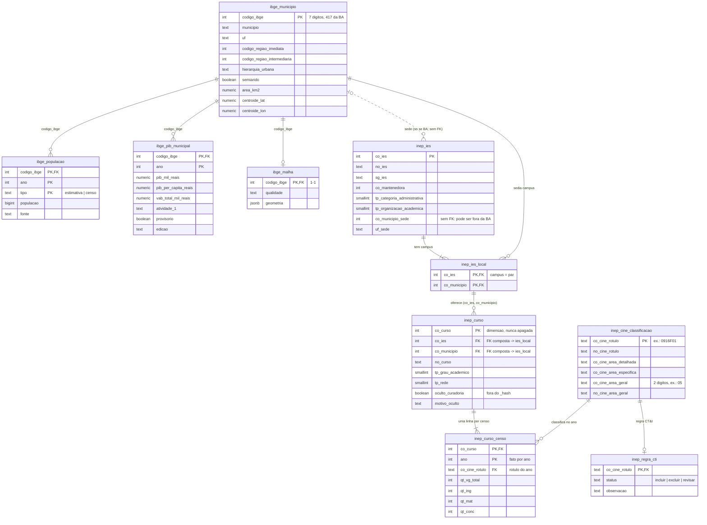
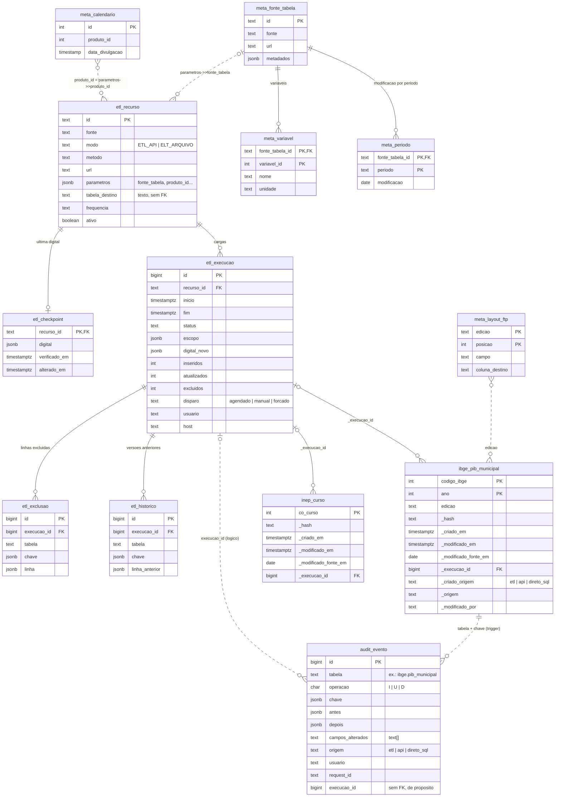

# MER atual: IBGE × INEP

Retrato em 2026-11-24, depois de `04_fk_ibge.sql` e `05_auditoria.sql`. **IBGE = implementado** (`orquestracao/sql/01` a `05`). **INEP = implementado** em `06_inep_modelo.sql` (desenho híbrido: dimensões que nunca se apagam, fato por ano, "ativo" derivado em view; `PLANEJAMENTO_IBGE.md` §7D). Censos 2021 a 2024 carregados.

**Legenda dos diagramas**
- Prefixo do nome: `ibge_`, `etl_`, `meta_`, `audit_` e `inep_` estão implementados. No banco, o primeiro `_` vira ponto: `ibge_municipio` = `ibge.municipio`.
- Linha cheia (`--`) = FK declarada no SQL. Linha tracejada (`..`) = relação lógica sem FK ou relação proposta. A tabela da §3 diz qual é qual.
- Colunas de controle (`_hash`, `_criado_em`, `_modificado_em`, `_modificado_fonte_em`, `_execucao_id`): ficam fora do diagrama 1 e aparecem no diagrama 2.

## 1. Domínio: município, IBGE e INEP

**Cardinalidades do campus e do curso**
- O campus é o par (`co_ies`, `co_municipio`); o INEP não tem código de campus, então dois campi da mesma IES no mesmo município viram um só.
- `curso` (dimensão) aponta para o campus por FK composta e tem uma linha em `curso_censo` por censo em que existiu. O curso que saiu do censo não é marcado: apenas não tem linha no ano vigente (`inep.v_curso_atual`).
- `co_ies` e `co_municipio` de `curso` refletem o último censo (33 cursos mudaram de IES entre 2022 e 2023). O rótulo CINE fica em `curso_censo`, porque muda por ano.
- `ies` → município da sede é opcional e **sem FK**: a sede pode ficar fora da BA (UNIVASF em PE, UNILAB no CE).
- Contagens em 2024: 144 IES, 216 campi; com a UNIVASF permanecendo (`exigir_sede_ba = false`), a view tem 552 cursos e 133 campi.

## 2. Controle e rastreabilidade

**Relação genérica:** toda tabela de dados tem `_execucao_id` → `etl.execucao.id` (0..1—N, FK declarada nas tabelas `ibge.*`). O diagrama mostra dois exemplos. No IBGE isso vale para `municipio`, `populacao`, `pib_municipal` e `malha`. No INEP vale, em proposta (§0), para `ies`, `ies_local`, `curso`, `cine_classificacao` e `regra_cti`. As staging (`stg.ibge_*`, `stg.inep_ies`, `stg.inep_cursos`, `stg.inep_abi`) não têm colunas de controle nem FK: são truncadas a cada carga. Em `etl.exclusao` e `etl.historico`, o alvo é identificado por `tabela` (text) + `chave` (jsonb), sem FK.

## 3. Situação de cada relacionamento

(a) = FK declarada no SQL · (b) = relação lógica sem FK · (c) = proposta ainda sem DDL (hoje nenhuma)

| Relacionamento | Card. | Tipo | Onde |
|---|---|---|---|
| `etl.checkpoint.recurso_id` → `etl.recurso.id` | 1—0..1 | (a) | `01_controle.sql` l.23 |
| `etl.execucao.recurso_id` → `etl.recurso.id` | 1—N | (a) | `01_controle.sql` l.31 |
| `etl.exclusao.execucao_id` → `etl.execucao.id` | 1—N | (a), coluna anulável | `01_controle.sql` l.45 |
| `etl.historico.execucao_id` → `etl.execucao.id` | 1—N | (a), coluna anulável | `01_controle.sql` l.55 |
| `meta.variavel` / `meta.periodo` → `meta.fonte_tabela` | 1—N | (a) | `03_ibge_modelo.sql` l.201, 208 |
| `ibge.populacao.codigo_ibge` → `ibge.municipio` | 1—N | (a) | `04_fk_ibge.sql` |
| `ibge.pib_municipal.codigo_ibge` → `ibge.municipio` | 1—N | (a) | `04_fk_ibge.sql` |
| `ibge.malha.codigo_ibge` → `ibge.municipio` | 1—0..1 | (a) | `04_fk_ibge.sql` |
| `_execucao_id` (tabelas `ibge.*`) → `etl.execucao` | 0..1—N | (a) | `04_fk_ibge.sql`; anulável: linha da API não tem carga |
| `audit.evento.tabela` + `chave` → qualquer tabela de dados | N—1 | (b) | genérica (jsonb); `execucao_id` sem FK de propósito |
| `etl.recurso.tabela_destino` → tabela final | — | (b) | text |
| `etl.recurso.parametros->>'fonte_tabela'` → `meta.fonte_tabela` | 0..1—N | (b) | jsonb, usada em `meta.v_status_dataset` |
| `etl.recurso.parametros->>'produto_id'` → `meta.calendario.produto_id` | N—N | (b) | jsonb, usada em `meta.v_status_dataset` |
| `ibge.pib_municipal.edicao` → `meta.layout_ftp.edicao` | N—N | (b) | sem chave única só em `edicao` |
| `etl.exclusao` / `etl.historico` (`tabela` + `chave`) → qualquer tabela | — | (b) | genérica, jsonb |
| `inep.ies_local.co_ies` → `inep.ies` | N—1 | (a) | `06_inep_modelo.sql` |
| `inep.ies_local.co_municipio` → `ibge.municipio` | N—1 | (a) | `06_inep_modelo.sql` |
| `inep.curso` (`co_ies`, `co_municipio`) → `inep.ies_local` | N—1 | (a) | FK composta |
| `inep.curso_censo.co_curso` → `inep.curso` | N—1 | (a) | `06_inep_modelo.sql` |
| `inep.curso_censo.co_cine_rotulo` → `inep.cine_classificacao` | N—1 | (a) | `06_inep_modelo.sql` |
| `inep.regra_cti.co_cine_rotulo` → `inep.cine_classificacao` | 0..1—1 | (a) | `06_inep_modelo.sql` |
| `_execucao_id` (tabelas `inep.*`) → `etl.execucao` | 0..1—N | (a) | `06_inep_modelo.sql` |
| `inep.ies.co_municipio_sede` → `ibge.municipio` | N—0..1 | (b), **sem FK de propósito** | a sede pode ser fora da BA |
| `inep.curso_censo.ano` → `etl.execucao.escopo->>'ano'` | N—N | (b) | usado por `inep.ano_vigente()` |

## 4. Inconsistências e lacunas

1. ~~Nenhuma FK no schema `ibge` e `_execucao_id` sem FK~~: **resolvido em 24/11** (`04_fk_ibge.sql`, `06_inep_modelo.sql`). O município carrega antes das filhas, e o ETL não exclui município que tenha filhas.
2. ~~Soft delete × exclusão por escopo~~: **resolvido em 24/11**. O INEP não tem `ativo`; dimensões sem DELETE (`p_excluir => false`) e fato por ano com trava de 20%.
3. **Edição pela API × recarga do ETL.** A fonte vence nos valores; a curadoria (`oculto_curadoria`) é preservada. Decisão a confirmar (`PLANEJAMENTO_IBGE.md` §7C).
4. **A sede da IES pode ficar fora da BA**, então não há FK para `ibge.municipio`.
5. **`CO_MUNICIPIO` do INEP** pode chegar como float (`2919207.0`); o orquestrador converte para inteiro. Códigos CINE são texto (rótulo tem letra, área tem zero à esquerda).
6. **Ligação com o Supabase não existe.** O `id_ativo` do painel (campus) e o `id_municipio` serial ainda não têm tabela de correspondência com `co_ies` e `codigo_ibge`; a tabela `ies_alias` do plano não foi criada.
7. **Campus sem código próprio.** O `id_ativo` do painel não tem correspondência 1:1 garantida (dois campi no mesmo município viram um). O município do INEP manda (decisão de 24/11): os 5 cursos do UNIMAM ficam em Cruz das Almas, mesmo que o painel use outro.
8. **Um recurso por censo** (`inep_censo_superior_<ano>`): `meta.v_status_dataset` mostra uma linha por ano carregado.
