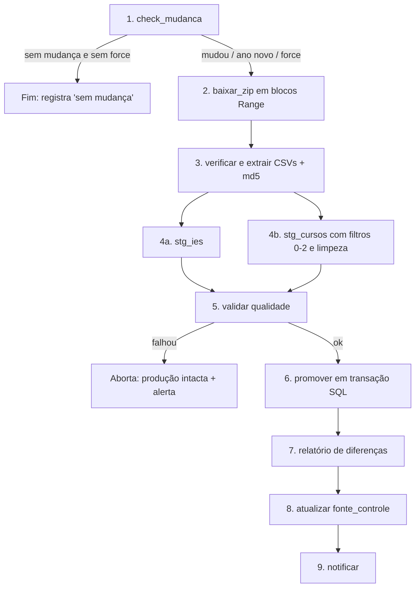

# Automação de ingestão — Apache Hop + PostgreSQL (TERRITÓRIOS SECTI)

Documento vivo. Registrar decisões, achados e pendências aqui. Datas em AAAA-MM-DD.

## 1. Objetivo
Automatizar a ingestão de dados oficiais (INEP primeiro) no banco do TERRITÓRIOS SECTI, detectando antes se a origem mudou, para não extrair à toa. Comparar o que já existe no Supabase com o que a fonte traz e apontar faltas (ex.: código IES).

## 2. Escopo inicial
- **Só INEP** (Censo da Educação Superior) é comparável hoje com o que há no TERRITÓRIOS SECTI.
- Demais fontes (IBGE, SICONFI, ANATEL, BNDES, ANEEL) entram depois, reaproveitando o mesmo controle de mudança.
- Primeiro **comparar e relatar**; só depois escrever em produção (upsert manual no começo).

## 3. Estado atual do TERRITÓRIOS SECTI (Supabase `vicaqpcluxkwbbbwdpkg`, lido em 2026-11-13 com a chave pública)
| Tabela | Linhas | Observação |
|---|---|---|
| `lista_cursos_cti` / `cursos` | 642 | 130 entidades; 92 EAD; sem `CO_CURSO`/`CO_IES` |
| `lista_ativos_cti` | 245 | 174 campi (tipos 5,7,8,9); 67 siglas distintas |
| `lista_municipioxterritorio` | 417 | `id_municipio` é serial 1–417, **não** é código IBGE |
| `stats_ti` | 27 | por território |
| `firjan` | 417 | `id_municipio` interno |
| `referencias` | 52 | |
| `tipo_ativos` / `tipo_cursos` / `tipo_cadeia` | 10 / 5 / 3 | |

Esquema (views, funções, RLS) não é visível com a chave pública.

## 4. Detecção de mudança na origem (testado 2026-11-13)
Nota: "não modificado" é **304**, não 204 (204 = sem conteúdo). Exige `If-None-Match` ou `If-Modified-Since`.

| Fonte | Mecanismo | Resultado |
|---|---|---|
| INEP zip (457 MB) | `GET` com `Range: bytes=0-0` → 206 + `Last-Modified` + `ETag` | `HEAD` falha (conexão resetada). Last-Modified 2026-07-10. Zip 2025 = 404 |
| SICONFI | ETag + `If-None-Match` | 304 confirmado |
| ANATEL zip (1 GB) | ETag + `If-Modified-Since` | 304 confirmado; Last-Modified 2026-11-04 |
| BNDES / ANEEL | CKAN `package_show` → `metadata_modified`, `resources[].last_modified` | sem ETag; BNDES CSV 2026-11-11, ANEEL SIGA 2026-11-01 |
| IBGE | novo período em `/agregados/{id}/periodos` | sem ETag/Last-Modified; `HEAD` = 405 |
| dados.gov.br | — | 401, exige token |

ANEEL: servidor derruba TLS com SNI (já documentado no repo); não contornar sem decisão explícita.

## 5. Modelo de dados proposto (rascunho — a validar)
- `territorio.municipio`: acrescentar `codigo_ibge` (7 dígitos, único). INEP `CO_MUNICIPIO` **é** o código IBGE (vem como float `2919207.0` → converter para inteiro). Preencher cruzando os 417 de `GET servicodados.ibge.gov.br/api/v1/localidades/estados/29/municipios` por nome normalizado; revisar os casos duvidosos.
- `ies(co_ies PK, nome, sigla, categoria_administrativa, organizacao_academica)`.
- `lista_ativos_cti.co_ies` FK nula, só para campi (tipos 5,7,8,9). Campus ≠ IES.
- `cursos.co_curso_inep` (nulo). **Em aberto:** chave natural real (`CO_CURSO` é único por município? EAD tem vários polos).
- Controle: `fonte_controle(fonte, recurso, url, etag, last_modified, source_modified_at, last_checked_at, last_changed_at, status, linhas)`.
- Schema `staging` para carga bruta antes do upsert.

## 6. Arquitetura Hop (rascunho)
1. Workflow `check_<fonte>`: sonda a origem (conforme §4), grava em `fonte_controle`. Sem mudança → encerra.
2. Se mudou: baixa → `staging` → relatório de diferenças contra produção.
3. Upsert em produção só após aprovação (manual no início).
4. Agendamento fora do Hop: cron / Agendador de Tarefas do Windows chamando `hop-run`.

### 6.1 Postgres local → VPS (decidido 2026-11-13)
- O schema é o que migra. Mantê-lo **como código**: scripts SQL numerados e versionados (`sql/001_...sql`, `002_...`), aplicados em ordem, para repetir igual local e na VPS. Nada de alterar tabela só pela interface.
- O Hop guarda a conexão em variáveis de ambiente (host, porta, banco, usuário, senha), e só isso muda entre local e VPS.
- Na VPS: Postgres sem exposição pública (acesso por túnel SSH/VPN ou firewall restrito), usuário do Hop com privilégios mínimos, backup (`pg_dump`) agendado.
- Schemas sugeridos: `staging` (carga bruta), `territorio` (dados finais), `controle` (`fonte_controle`, logs de execução).

### 6.2 Docker versionado (decidido 2026-11-13)
- Hop roda em **container na VPS**. Postgres também em container.
- Tudo que define o ambiente vai no git: `docker-compose.yml`, `Dockerfile` do Hop (se precisar), `sql/`, projeto Hop (workflows/pipelines/metadados), `.env.example`. **Fora do git:** `.env` real (senhas) e os volumes de dados.
- Versões fixas (nada de `latest`): imagem do Postgres e do Hop com tag exata, registrada aqui.
- Computador de trabalho x casa: `git clone` + copiar `.env` + `docker compose up`. O mesmo compose sobe na VPS, mudando só o `.env`.
- Risco: Docker Desktop em máquina corporativa pode exigir licença e/ou virtualização (WSL2) bloqueada pela TI. Alternativa: Postgres nativo local só para teste, e o container só na VPS.
- **Sem Docker local** (alternativa): versiona-se o mesmo conteúdo, trocando o compose por `README`/script de instalação com as versões fixadas (Postgres major igual ao da VPS, Java 21 + Hop da mesma versão do container) e `sql/apply.ps1` que aplica `sql/*.sql` em ordem via `psql`. O que muda: o ambiente local deixa de ser idêntico ao da VPS, então validar o schema na VPS antes de confiar.
- **Linux versionado (decidido 2026-11-13):** não se versiona a imagem/disco (`wsl --export`, VM), só a receita: `setup.sh` idempotente com versões fixas (Postgres, Java 21, Hop) que deixa qualquer Ubuntu/Debian zerado igual, no WSL2 ou na VPS. Se adotar Docker, o `setup.sh` vira o corpo do Dockerfile. Ansible/cloud-init só se a VPS crescer.
- **Bloqueio local (2026-11-13):** o Docker Desktop 4.99.0 falhou na instalação: exige o recurso "Virtual Machine Platform" do Windows, desativado, e ativá-lo requer administrador (que o usuário não tem). `wsl --install` cai no mesmo bloqueio. Virtualização na BIOS já está ativa (Ryzen 3 PRO 5350GE).
  - **Caminho A (pedir à TI):** habilitar uma vez `VirtualMachinePlatform` e `Microsoft-Windows-Subsystem-Linux` (+ reinício). Depois o Docker Desktop instala "per-user" sem admin.
  - **Caminho B (sem admin, em andamento):** ambiente local em user-space: Postgres via binários zip (`initdb`/`pg_ctl`, porta local), Java 21 portátil (zip) e Hop (zip). **Versão do Hop (corrigido 2026-11-13):** a estável mais recente é a 2.20.0 (02/11/2026) e exige **Java 21** (obrigatório desde a 2.18; 2.10–2.17 usavam Java 17). Fonte: hop.apache.org/download. Docker fica só na VPS; local e VPS usam o mesmo major do Postgres e o mesmo `sql/`.
- **A definir:** distribuição e versão do Linux da VPS (para fixar no `setup.sh`).
- Estrutura prevista da pasta:
  ```
  automacao-hop-postgres/
    PLANO.md
    docker-compose.yml
    .env.example
    sql/            # 001_*.sql, 002_*.sql ...
    hop/            # projeto Hop (workflows, pipelines, metadados)
  ```

## 7. Segurança
- A chave pública do Supabase está no código/bundle. Só testei **leitura**. Verificar RLS: se escreve, qualquer um altera o banco.
- Hop usa credencial própria (service role ou Postgres direto) em `.env`, nunca a chave pública. Não versionar.

## 8. Pendências / perguntas em aberto
- [x] Onde roda o PostgreSQL? **Decidido (2026-11-13):** Postgres novo e local para teste; depois migra para uma VPS, pelo menos o schema completo. Não conecta no Postgres do Supabase.
- [x] Hop: **Decidido (2026-11-13):** usar a versão estável mais recente. Confirmar o número exato na instalação e registrar aqui.
- [ ] Onde Postgres e Hop serão instalados localmente (nativo no Windows ou Docker Desktop)? Está instalado algum dos dois?
- [x] Migração para a VPS: **Decidido (2026-11-13):** vai só o schema, sem conteúdo; o Hop carrega os dados na VPS. Usar `pg_dump --schema-only` ou, melhor, os próprios SQL numerados (§6.1).
- [ ] Docker na VPS: não exige Docker local, mas recomendado rodar o Postgres local em Docker com a **mesma imagem/versão** da VPS (ex.: `postgres:17`), para não haver diferença de versão. Decidir.
- [ ] Confirmar RLS de escrita da chave pública.
- [ ] Confirmar `CO_CURSO`: unicidade por município/polo (precisa do zip INEP completo).
- [ ] Gerar correspondência `id_municipio` ↔ `codigo_ibge`.

## 9. Próximos passos
1. Baixar INEP 2024 (pasta isolada), filtrar BA, cruzar com `lista_cursos_cti` e `lista_ativos_cti` por nome + município → relatório de faltas/divergências.
2. DDL de `ies`, `codigo_ibge` e `fonte_controle` para revisão.
3. Protótipo do workflow `check_inep` no Hop.

## 9b. INEP — achados para o plano de ingestão (2026-11-13)
Inspecionado o zip do Censo da Educação Superior 2024 **sem baixar tudo** (leituras `Range` com `curl`; o Python recebe `connection reset` do servidor do INEP, o `curl` não).

**Conteúdo do zip (457 MB, armazenado sem compressão):**
| Membro | Tamanho |
|---|---|
| `dados/MICRODADOS_CADASTRO_CURSOS_2024.CSV` | 453 MB — o Brasil inteiro, ~200+ colunas |
| `dados/MICRODADOS_ED_SUP_IES_2024.CSV` | 1 MB — 2.561 IES no Brasil, 145 com sede na BA |
| `Anexos/.../dicionário_dados_educação_superior.xlsx` | dicionário oficial (54 KB) |
| `dados/md5_microdados_ed_superior_2024.txt` | md5 dos CSVs (139 B); **cita nomes diferentes** (`..._CADASTRO_IES_2024.csv`) dos arquivos reais (`..._ED_SUP_IES_2024.CSV`) |

**Formato:** separador `;`, codificação `latin1`. Códigos CINE devem ser lidos como texto (zeros à esquerda).

**Chaves e granularidade:**
- Cursos: `CO_IES`, `CO_CURSO`, `CO_MUNICIPIO` (**código IBGE de 7 dígitos**), `TP_DIMENSAO` (1 presencial, 2 EAD por município/polo, 3 EAD só Brasil, 4 exterior). O arquivo de cursos **não** traz nome/sigla da IES: vem do join com o arquivo IES por `CO_IES`.
- IES: `CO_IES`, `NO_IES`, `SG_IES`, `CO_MANTENEDORA`, `NO_MANTENEDORA`, endereço, município da sede, docentes.
- **Não há código de campus.** O campus do Supabase (`id_ativo`) só pode ser casado por **(`co_ies`, `co_municipio`)**.
- **Filtro de IES não pode ser `SG_UF_IES = 'BA'`**: IES com sede fora da BA que têm campus/polo na BA (ex.: UNIVASF, sede em PE) ficam de fora. Pegar as IES a partir dos **cursos com `CO_MUNICIPIO` na BA** e só depois juntar com o arquivo IES.

**Cruzamento inicial com o Supabase (campi, tipos 5/7/8/9):** 156 de 174 casam com INEP por sigla ou nome normalizado (134 por sigla, 90 por nome exato). Sem casamento: IF Baiano (variação de sigla) e UNIVASF (sede fora da BA). Precisará de tabela de alias (`ies_alias`) para variações de nome/sigla.

**Detecção de mudança do INEP:**
1. `GET` com `Range: bytes=0-0` na URL do ano atual → `ETag` e `Last-Modified` (2024: 10/07/2026). O `HEAD` não funciona.
2. Sondar também a URL do **próximo ano** (`..._2025.zip`): hoje 404; quando virar 200, há censo novo.
3. Conferir o md5 do CSV após baixar (para integridade, sabendo da divergência de nomes no arquivo `md5`).
Como o Censo é anual e fechado, a sondagem deve ser rara (ex.: semanal) e o grosso da carga é única por ano.

**Limitação local:** esta máquina não tem Python de sistema; os scripts do repo (`requests`) não rodam aqui sem instalar. O Hop (Java) não depende disso.

**Filtros de escopo (decididos 2026-11-13):**
- **Só Bahia.** O filtro territorial é o código IBGE, em duas camadas: (1) `CO_UF = 29` (os 2 primeiros dígitos do código municipal são o código da UF; 29 = Bahia) e (2) `CO_MUNICIPIO` ∈ lista dos 417 municípios do IBGE (`localidades/estados/29/municipios`). A camada 2 é a trava de qualidade: descarta qualquer código inválido ou de outro estado. `SG_UF = 'BA'` é redundante com `CO_UF = 29`. No arquivo de cursos, UF/município são os do **local de oferta**; no arquivo IES, os campos `*_IES` são os da **sede** (a confirmar nos dados).
- **Sem cursos EAD:** só presencial (`TP_MODALIDADE_ENSINO = 1` / `TP_DIMENSAO = 1`). Isto também elimina o problema de múltiplos polos por `CO_CURSO`.
- ⚠️ **Conflito a resolver:** o Supabase tem hoje **92 cursos com `ead = true`** (de 642). Decidir: remover esses 92 do banco, mantê-los marcados como legado, ou manter EAD só nos dados antigos.
- Os filtros ficam em **uma tabela de parâmetros** (UF, modalidade, ano), não fixos no código do pipeline, para o Hop ler.

**Arquivos baixados:** `C:\Users\joao.vinicius\dados-inep\2024\` (fora do repo, para não versionar 457 MB; dados tratados como não confiáveis, lidos só por script em outra pasta).

**Resultados com o zip completo (baixado e verificado 2026-11-13):**
- Download: o servidor reseta `GET` sem `Range`; baixado em blocos de 16 MB. Tamanho = 456.807.449 B, `testzip` OK, **md5 dos dois CSVs confere** com o arquivo `md5` do INEP.
- **Funil Bahia:** 720.349 linhas no Brasil → 40.715 com `CO_UF = 29` → 40.715 também na lista dos 417 municípios (nenhum código inválido). Em todas as linhas o prefixo de `CO_MUNICIPIO` = `CO_UF` ⇒ UF/município do arquivo de cursos são mesmo o **local de oferta**.
- **EAD é 95% da Bahia:** 38.864 linhas EAD (polos) × **1.851 presenciais**. Com o filtro presencial sobram 1.851 linhas.
- ⚠️ `QT_CURSO` soma 1.834 nas 1.851 linhas: 17 linhas têm `QT_CURSO = 0`. A investigar antes de decidir se entram.
- **`CO_CURSO` é único** nos presenciais da BA: 1.851 códigos distintos, nenhum em mais de uma IES, nenhum em mais de um município, nenhum (curso, município) repetido ⇒ **PK natural = `co_curso`** (só vale presencial; EAD não foi testado).
- **IES:** 144 IES têm curso presencial na BA; **2 têm sede fora** (UNILAB, UNIVASF); 3 IES com sede na BA não têm curso presencial na BA. Confirma: derivar IES dos cursos, não de `SG_UF_IES`.
- **Casamento com os 642 cursos do Supabase** (nome do curso + município, normalizados): dos 550 presenciais, 550 existem no INEP por nome+município, **mas só 393 (71%) resolvem para um único `CO_CURSO`** quando se usa a sigla da IES; 157 ficam ambíguos (mesmo curso/município em várias IES, ou sigla do Supabase ≠ `SG_IES`). Dos 92 EAD do Supabase, 76 acham um curso presencial de mesmo nome/município e 16 não acham nada. **O 100% de "casa" não prova nada:** só diz que o nome existe naquele município.
- **Estratégia de casamento (2 passos):** (1) mapear cada campus do Supabase (`id_ativo`) a um `co_ies` por (sigla/nome, município) + tabela `ies_alias` para as exceções; (2) casar o curso por (`co_ies`, nome normalizado, município) → `co_curso`. Medir a taxa de resolução depois do passo 1.

**Decisões (2026-11-13):**
- **Filtro territorial em duas camadas aprovado:** `CO_UF = 29` e `CO_MUNICIPIO` ∈ 417 códigos IBGE.
- **Supabase atual = somente leitura.** Nada é escrito, alterado ou removido lá. Tudo acontece no Postgres novo; o Supabase serve só de referência para consulta e comparação. Isso encerra a pergunta dos 92 cursos EAD: ficam intocados no Supabase; no Postgres novo entram só presenciais.

**Passo 1 medido (campus → `co_ies`, só leitura, 2026-11-13):** casamento por sigla (ignorando espaços/acentos) ou nome, **confirmado** quando a IES candidata tem curso presencial naquele município no INEP.
| Campi do Supabase (174) | Qtde |
|---|---|
| Resolvidos e confirmados (IES oferece curso presencial no município) | 159 |
| IES única, mas sem curso presencial no município em 2024 | 13 |
| Ambíguos (Salvador: UNIJORGE/Faculdade Diplomata e UNIRB: duas IES candidatas) | 2 |
| Sem candidata | 0 (o IF Baiano resolveu depois de ignorar espaços na sigla) |

**Passo 2 medido (curso → `co_curso`):** dos 550 cursos presenciais do Supabase, **460 (84%) resolvem para um único `CO_CURSO`**; 49 ficam ambíguos (mesma IES + nome + município com mais de um `CO_CURSO`, provavelmente grau ou turno diferentes → precisa de desempate por `TP_GRAU_ACADEMICO`/rótulo CINE); 41 pertencem a campi ainda sem `co_ies` (inclui os 2 ambíguos).

**IES: matriz ou campi? (2026-11-13)** O arquivo IES do INEP é **por instituição (matriz/sede)**: 1 linha por `CO_IES`, só com o município da sede/reitoria e o endereço da sede. **Campus/local de oferta não existe nele**: só aparece no arquivo de cursos, via `CO_MUNICIPIO`. Das 144 IES com curso presencial na BA, 132 oferecem em 1 município e 12 em mais de um (UNEB 25, IFBA 18, IF Baiano 10, UFRB 6, UFOB 5, UNIDOMPEDRO 4, …). O Supabase (`lista_ativos_cti`) é **por campus**. Logo, o campus no Postgres novo = par (`co_ies`, `co_municipio`), derivado dos cursos.

**Filtros do INEP (consolidado 2026-11-13), aplicados nesta ordem sobre `MICRODADOS_CADASTRO_CURSOS_2024.CSV`:**
| # | Filtro | Linhas restantes |
|---|---|---|
| 0 | `NU_ANO_CENSO` = ano do parâmetro (2024) | 720.349 (Brasil) |
| 1 | `CO_UF = 29` | 40.715 |
| 2 | `CO_MUNICIPIO` ∈ 417 códigos IBGE da BA | 40.715 |
| 3 | `TP_MODALIDADE_ENSINO = 1` (presencial; só presencial, sem EAD) | 1.851 |
| 4 | `QT_CURSO = 1` (exclui as 17 ABI → `staging` com `eh_abi`) | 1.834 |
| 5 | **CT&I:** `CO_CINE_ROTULO` na lista `regra_cti` (`incluir`) | **≈ 552** (55 rótulos; 6 a revisar) |
| 6 | **IES com sede na BA** (`CO_UF_IES = 29`, do arquivo IES) — *metodologia do Supabase, a confirmar* | 552 → **547** cursos (−5 da UNIVASF, sede em Petrolina/PE); 91 → 90 IES; 133 → 132 pares |

**Metodologia do consultor, reconstituída do Supabase (2026-11-13, só leitura).** O Supabase não guarda o tipo nem os filtros; cruzei os 642 cursos com o INEP 2024 (nome + município + IES do campus) e inferi:
1. **Tipo (`categoria`) = `NO_CINE_AREA_GERAL` do INEP:** 550 de 550 presenciais batem (5 tipos = áreas 05, 06, 07, 08, 09). O tipo é recuperável pelo cruzamento.
2. **Só áreas gerais 05–09; licenciaturas fora.** Dos 43 cursos do INEP com nome da lista mas ausentes no Supabase, **37 são licenciaturas da área 01** (formação de professores: Matemática, Biologia, Química, Física). Nos 21 casos de nome repetido (licenciatura × bacharelado), o Supabase tem **uma** linha onde o INEP tem duas, e só **uma** das duas é de área 05–09 → o consultor ficou com a de área 05–09. **Isso resolve a ambiguidade dos 21 cursos:** vale a linha cuja área é 05–09.
3. **Lista de rótulos dentro das áreas 05–09** (Saúde assistencial e Arquitetura fora; ver `regra_cti`). Não há curso de rótulo "da lista" com nome diferente faltando: a lista por nome coincide com a lista por rótulo.
4. **IES com sede na BA (inferência forte, não confirmada):** os 6 cursos CT&I restantes ausentes são todos da **UNIVASF** (sede em Petrolina/PE; cursos em Juazeiro e Senhor do Bonfim); nenhum curso UNIVASF existe no Supabase (0), embora ela tenha 9 cursos em áreas 05–09 na BA. UNILAB (sede em CE) não tem curso em 05–09, sem evidência. Logo o consultor parece ter filtrado por **sede da IES na BA**, e não pelo local do curso.
5. **Sem filtro por rede, categoria administrativa, grau ou município:** privadas (376 de 383 presentes) e públicas (205 de 241) entram; tecnológicos e bacharelados entram; as 9 públicas ausentes que não são licenciatura são as da UNIVASF.
6. **Inclui EAD (92 linhas, por polo)**; todos os 92 casam com linhas EAD do INEP. **Nosso escopo exclui EAD**, então aqui nasce a diferença deliberada.
7. **Os 14 pares "duplicados" não são erro:** o INEP também tem 2 `CO_CURSO` nesses grupos (ofertas distintas). Em 474 grupos (IES, curso, município) a contagem Supabase = INEP.
8. **ABI:** o Supabase não tem nenhuma.
**Decisão que decorre disso:** para seguir "a mesma metodologia", entra o filtro 6 (IES com sede na BA). Isso **exclui 5 cursos CT&I da UNIVASF que são oferecidos na Bahia** (Juazeiro e Senhor do Bonfim; a UNIVASF tem 9 cursos em áreas 05–09 antes da lista de rótulos; **corrigido:** a primeira estimativa, de 9, não aplicava a lista de rótulos). Manter a exclusão (igual ao Supabase) ou incluí-los (mais correto territorialmente)?

**Desenho de `ies` e `ies_local` (decidido 2026-11-13, a detalhar):**
- **Fonte de existência = dataset de cursos**, não o arquivo IES consolidado. A orquestração pega os cursos filtrados, separa os pares (`co_ies`, `co_municipio`) únicos e grava em `ies_local`; `curso` segue como está. O arquivo IES serve **só como consulta de atributos** (`LEFT JOIN` por `co_ies`): o CSV de cursos só tem `CO_IES`, sem nome, sigla ou mantenedora. Todos os `CO_IES` dos cursos existem no arquivo IES (0 faltando).
- **Quantos, conforme o ponto de corte:** após filtro 4 (todas as áreas): **144 IES, 216 pares**; após filtro 5 (CT&I): 91 IES, 133 pares; após filtro 6: 90 IES, 132 pares. Das 145 IES com sede na BA no arquivo IES, 3 não têm curso presencial na BA e 55 não têm curso CT&I.
- **IES nunca é apagada:** carga só com *upsert*; sem `DELETE`. Colunas de controle: `primeira_carga`, `ultimo_ano_visto`, `ativa`. IES/campus que sumir de um censo fica com `ativa = false`, não é removida.
- **A API só devolve campus que tenham curso:** vista `v_campus_com_curso` (`ies_local` *inner join* `curso`). IES e campus sem curso permanecem no banco, mas não aparecem na API.
- **Ponto de corte de `ies`/`ies_local`:** sugestão = **após o filtro 4** (144/216), para que IES e campus sem curso CT&I hoje sejam mantidos e apareçam sozinhos se a `regra_cti` mudar; `curso` usa o filtro 5 (e 6).
- **Limite:** o campus é o par IES + município; dois campi da mesma IES no mesmo município viram um só.
- `ies` e `ies_local` saem **dessa mesma base filtrada**: `ies` = `CO_IES` distintos juntados ao arquivo IES; `ies_local` = pares (`CO_IES`, `CO_MUNICIPIO`) distintos. Com o filtro 4 são 144 IES; com o filtro CT&I (5) o número cai (nas áreas 05–09, antes da lista de rótulos, eram 113 IES e 160 pares; recalcular com `regra_cti`). Consequência: campus/IES sem curso CT&I **não** entram.
- Todas as linhas filtradas têm `TP_NIVEL_ACADEMICO = 1` (graduação), então esse filtro seria redundante (pode virar parâmetro).
- **CT&I é filtro (decidido 2026-11-13):** o Hop aplica um 5º filtro, autônomo, por **lista de rótulos CINE** (`CO_CINE_ROTULO ∈ regra_cti` com `incluir = true`). A tabela `regra_cti` fica no Postgres e o Hop só a lê. Os 1.834 cursos não-CT&I não entram no catálogo (ficam apenas em `staging` se quisermos auditoria).
- **Por que lista de rótulos e não área CINE 05–09:** a lista atual da SECTI (Supabase) **não** é "todas as áreas 5–9". Nessas áreas o INEP tem 935 cursos presenciais na BA, mas o Supabase cobre 551: áreas 05/06/07/08 casam 89–100%, e a área **09 (Saúde) só 23%**, porque a SECTI incluiu apenas Biomedicina, Farmácia, Radiologia e "Programas interdisciplinares abrangendo saúde" e excluiu Enfermagem, Fisioterapia, Nutrição, Odontologia, Medicina, Educação física, Serviço social, Fonoaudiologia, Terapia ocupacional; na 07 excluiu Arquitetura e urbanismo. Medindo por rótulo CINE, a separação é quase limpa: de 71 rótulos, 51 têm 100% casados, 14 têm 0% e 6 são mistos/pequenos.
- **Resultado:** 55 rótulos propostos como `incluir` (≥ 90% casados) = **552 cursos**, ≈ os 550 presenciais do Supabase. 10 rótulos `excluir` e 6 `revisar` (Ecologia, Geologia, Eng. de agrimensura e cartográfica, Eng. agrícola, Optometria, Saúde coletiva: poucos cursos, 1–3 cada). Lista completa em `analise/regra_cti_rotulos.csv`.
- **Hierarquia CINE e sub-filtro:** o INEP classifica em 4 níveis: **área geral** (2 dígitos, 10 áreas) → **específica** (3) → **detalhada** (4) → **rótulo** (7 caracteres, ex.: `0916F01` Farmácia). O sub-filtro CT&I acontece no **rótulo**, dentro das áreas 05–09; as áreas 01–04 e 10 ficam fora por inteiro. Nível detalhado quase serve, mas mistura rótulos incluídos e excluídos em 0731 (Arquitetura × Agrimensura) e 0914 (Biomedicina/Radiologia × Optometria). Árvore completa com status em `analise/cine_hierarquia_cti.txt`.
- **Parecer independente (modelo Opus, 2026-11-13, só leitura) — relação dos rótulos com CT&I:**
  - **Critério usado:** C1 base científico-tecnológica do currículo; C2 ligação com P&D/inovação setorial; C3 exclusão assistencial (ocupação dominante = atendimento direto). `incluir` = C1 e C2 sem C3; `excluir` = C3 sem C2 forte; `revisar` = misto.
  - **Achado de base:** excluir Medicina/Enfermagem é **escolha de política da SECTI**, não fato técnico (pelo Frascati, saúde e agrárias são campos de C&T; pelo critério STEM da OCDE, só áreas 05–07).
  - **Farmácia (0916F01): incluir, confiança alta** — discorda de que não tenha relação (indústria farmacêutica = alta intensidade de P&D). **Biomedicina (0914B01): incluir, confiança média** — mais fraca que Farmácia (mercado dominante é análise clínica; 39 de 41 cursos privados). **Radiologia (0914R01): revisar, tendência a excluir** (tecnólogo que opera equipamento; incluir Radiologia e excluir Enfermagem não se sustenta por um critério único). **Arquitetura (0731A02): excluir, média** (decisão de política). **Engenharia civil: incluir, média** (59 cursos; maior peso do catálogo).
  - **Divergências reais da regra proposta (3):** `0712G01` Gestão ambiental → revisar (viés de gestão); `0914R01` Radiologia → revisar/tendência a excluir; `0988P01` Interdisciplinares em saúde (BIs, porta de entrada de Medicina/Enfermagem) → revisar.
  - **6 rótulos "revisar" resolvidos pelo parecer:** incluir Ecologia, Geologia, Agrimensura e cartográfica, Engenharia agrícola; excluir Optometria e Saúde coletiva (esta com confiança baixa).
  - **Licenciaturas:** nos rótulos 05–09 só há grau 1 (bacharelado) e 3 (tecnológico); as licenciaturas em Física/Química/Matemática/Biologia/Computação estão na **área 01** (rótulos `0114*`), então o filtro por rótulo **já as exclui**. Recomendação: não contar como CT&I; se a SECTI quiser, categoria separada (`educacao_cientifica`) via linhas explícitas em `regra_cti`. Verificação minha: dos 550 cursos presenciais do Supabase, 526 casam só com áreas 05–09, 24 casam com áreas 05–09 **e** com uma licenciatura de mesmo nome (ambíguos, ver os 21 do `cursos_ambiguos.csv`), e **nenhum** casa só com licenciatura.
  - **Variáveis:** `TP_GRAU_ACADEMICO` como atributo (não como regra: excluiria TIC tecnológica); `TP_ORGANIZACAO_ACADEMICA` e dados de docentes da IES só como atributo/contexto; `QT_*` como indicador, não como corte. **Não usar como filtro:** `TP_REDE`, `TP_CATEGORIA_ADMINISTRATIVA`, `IN_GRATUITO`, `IN_COMUNITARIA`, `IN_CONFESSIONAL` (o privado domina rótulos centrais; distorce o mapa) e `NO_CURSO`/regex.
  - **Rótulos novos:** podem surgir presenciais hoje só-EAD (ex.: `0612S01`, `0714A01`); vão para `cti_nao_classificado`, com sugestão padrão por área (05/06/07 → provável incluir; 08/09 → revisar), sem incluir automaticamente.
  - **Decisões de política que só a SECTI pode tomar:** (1) conceito de CT&I, estreito (STEM, áreas 05–07) ou amplo (Frascati, com saúde e agrárias); (2) Radiologia e, por coerência, Optometria; (3) BI em Saúde; (4) Arquitetura e Engenharia civil; (5) Medicina veterinária entra e Medicina não; (6) licenciaturas em ciências; (7) cursos com viés de gestão (Gestão ambiental, Gestão de TI, Engenharia de produção).
  - **Não verificado:** as fontes externas do parecer (Frascati, OCDE, Lei 10.973) foram citadas de memória, sem conferência online; currículos das IES; a tabela por rótulo completa (71 linhas) está só no relatório do revisor, não salva em arquivo.
- **Como o filtro é feito tecnicamente (decidido 2026-11-13):** por **código**, não por nome, e o código é **texto**, não número. `CO_CINE_ROTULO` é `varchar(7)` (ex.: `0916F01`, tem letra); `CO_CINE_AREA_GERAL` é texto de 2 dígitos (`05`, com zero à esquerda; ler como inteiro vira `5` e quebra o cruzamento). **Armadilha no arquivo:** o `CO_CINE_ROTULO` vem com aspas literais dentro do campo (cru: `"""0011A09"""` → depois do CSV, `"0011A09"`); o Hop precisa remover as aspas e aplicar `trim` antes de comparar. Nomes (`NO_CINE_ROTULO`) não entram no filtro: têm acento e mudam de grafia entre censos.
- **Execução no Hop:** *Stream lookup / merge join* de `curso_staging.co_cine_rotulo` com `regra_cti.co_cine_rotulo` (`incluir = true`); `regra_cti.co_cine_rotulo` é PK e FK para `cine_classificacao`. **Rótulo que não existe em `regra_cti`** (código novo numa revisão do CINE) **não é descartado em silêncio**: vai para uma saída `cti_nao_classificado` e o pipeline avisa, para decisão humana.
- **Origem da regra:** derivada do Supabase em leitura (2026-11-13), por inferência (a SECTI não publicou a regra por escrito). A regra mecânica do repo (áreas 5–7 = núcleo, 8–9 = ampliado) daria 935 cursos e **não reproduz** a lista atual.
- Todos os filtros (ano, UF, modalidade) ficam em tabela de parâmetros lida pelo Hop.

**Tabelas propostas (rascunho, a confirmar):**
- `ies` — uma linha por `co_ies` (nome, sigla, mantenedora, categoria administrativa, organização acadêmica, município da sede).
- `ies_local` — (`co_ies`, `co_municipio`), o "campus"; opcional: guarda o `id_ativo` do Supabase como referência de leitura.
- `curso` — PK `co_curso`; FK `co_ies`, `co_municipio`, FK para classificação.
- `cine_classificacao` — categorização do curso. O INEP traz a hierarquia CINE em 4 níveis (área geral 2 dígitos → específica 3 → detalhada 4 → rótulo 7 caracteres). Os arquivos `categorias_cti/inep_cine_areas_BA_nivel_cti.csv` (80 linhas) e `inep_cine_rotulos_BA_nivel_cti.csv` (240 linhas) já têm isso para a BA, com `nivel_cti` (núcleo/ampliado/fora). Os 5 `tipo_cursos` do Supabase correspondem às áreas gerais CINE 05–09.

**13 campi "IES única, sem curso presencial no município" (provável causa: campi de IF/UNEB sem curso de graduação presencial em 2024, só técnico/médio; não verificado):** IF Baiano (`co_ies 14509`): Alagoinhas, Governador Mangabeira, Itaberaba, Salvador, Xique-Xique. IFBA (`co_ies 599`): Campo Formoso, Euclides da Cunha, Ilhéus, Jaguaquara, Seabra, Ubaitaba. UNEB (`co_ies 40`): Canudos, Jeremoabo.

**49 cursos ambíguos (linhas completas em `analise/cursos_ambiguos.csv`, 1 linha por candidato do INEP) — 2 causas:**
- **21 linhas: licenciatura × bacharelado** com o mesmo nome (Ciências Biológicas, Física, Matemática, Química em UFOB, UESC, UFBA, UESB, UEFS, UFRB, UNEB): dois `CO_CURSO`, `TP_GRAU_ACADEMICO` 2 e 1. O Supabase não tem grau, então não dá para escolher só pelo nome.
- **28 linhas = 14 pares duplicados no próprio Supabase** (UniRuy, UNIFACS, UNINASSAU, UniFTC): a mesma linha duas vezes, e o INEP também tem 2 `CO_CURSO` (ofertas/turnos distintos, um deles às vezes com matrícula 0). Ligação 1:1 impossível de decidir sem outro dado.

**Pendências do INEP:**
- [ ] Revisar os 13 campi "sem curso presencial no município" e os 2 ambíguos (alias manual em `ies_alias`).
- [ ] Desempate dos 49 cursos ambíguos (grau acadêmico / rótulo CINE).
- [x] 17 linhas com `QT_CURSO = 0` investigadas (2026-11-13) — ver "Linhas com `QT_CURSO = 0`" abaixo.

**Linhas com `QT_CURSO = 0` (presenciais da BA) — o que são:** são as **Áreas Básicas de Ingresso (ABI)**, trilhas de entrada em que o aluno ingressa numa área e só depois escolhe o curso (ex.: UFBA "Abi - Física", UFSB "Abi - Licenciaturas Interdisciplinares"). Evidências: (1) **16 das 17 têm "Abi -" no nome**; a 17ª é a IFBA "Computação" (`5001423`), sem o prefixo, com o mesmo padrão; (2) **todas têm `TP_GRAU_ACADEMICO` vazio**, e nenhuma das 1.834 linhas com `QT_CURSO = 1` tem grau vazio (separação perfeita na BA); (3) o questionário do INEP (Módulo Curso 2024) tem o campo "Atributo de curso: Normal / Área básica de ingresso". Não há coluna do atributo no CSV (223 colunas), então a identificação é por inferência (grau vazio + `QT_CURSO = 0`), e a 17ª linha como ABI é inferida, não confirmada. O prefixo de código 5000/5001 **não** serve de marcador: 33 cursos normais também o têm. **Não são cursos:** o INEP não os conta (`QT_CURSO = 0`), mas elas carregam alunos (3.456 matrículas, 1.356 ingressantes, 1.797 vagas), que depois se distribuem entre os cursos finais.
**ABI e CT&I:** todas as 17 têm `CO_CINE_AREA_GERAL = 00 – Programas básicos` (fora das áreas 5–9 que o projeto usa para CT&I), então pela regra mecânica **nenhuma é CT&I**. Mas o `NO_CINE_ROTULO` delas diz a área de destino ("ABI Computação e TIC", "ABI Ciências naturais, matemática e estatística", etc.), e o rótulo da IFBA "Computação" ("ABI Computação e Tecnologias…") confirma que ela é ABI. Pelo rótulo: **6 apontam para CT&I** (4 de ciências naturais/matemática: Biológicas, Física, Matemática, Química = ~1.114 matrículas e 610 vagas, + Computação IFBA = 16 matrículas, 60 vagas → "núcleo STEM"; + Educação Física do IF Baiano, rótulo Saúde e bem-estar = 37 matrículas, 40 vagas → "ampliado") e 11 não (Educação, Artes e humanidades, Ciências sociais). Ressalva: ABI é trilha de entrada, o aluno pode terminar em qualquer curso; atribuir à área do rótulo é aproximação. **Decidido (2026-11-13):** **não incluir** as ABI nos indicadores CT&I. O catálogo de cursos fica só com `QT_CURSO = 1`; as ABI ficam em `staging` com `eh_abi = true`. Motivo: os cursos finais já contam esses alunos quando eles se distribuem, então incluir as ABI poderia contar a mesma pessoa duas vezes.

**Regra proposta:** no catálogo de cursos, manter só `QT_CURSO = 1` (exclui as 17); guardar as ABI em `staging` com um flag `eh_abi = true` para não perder os totais de matrícula se um dia forem somados. O Supabase atual não tem nenhuma ABI (0 cursos com nome "Abi…"). Observação nacional: no Brasil, `QT_CURSO = 0` é o valor da grande maioria das linhas EAD (polos); entre os presenciais há 4 casos com grau vazio e `QT_CURSO = 1`, então a regra não é absoluta fora da Bahia.
- [ ] Mapear campi → `co_ies` (passo 1) e medir a taxa final de resolução dos 550 presenciais.

## 9c. Orquestração INEP no Hop — desenho passo a passo (rascunho 2026-11-13)

**Princípios:** idempotente (reexecutar não duplica); nada vai para produção sem passar nas validações; nada é apagado (só `ativo = false`); o check de mudança vem primeiro, para não baixar 457 MB à toa; filtros e regras vivem em tabelas, não no código do pipeline.



**Pré-requisitos (carga única, antes do 1º ciclo):** `municipio` (417 códigos IBGE, da API de localidades); `cine_classificacao` e `regra_cti` (semente a partir de `analise/regra_cti_rotulos.csv` e da hierarquia); `controle.parametro` (ano, `uf = 29`, `modalidade = 1`, `exigir_sede_ba`); `controle.fonte_controle`.

| # | Etapa (arquivo Hop) | O que faz | Componente Hop | Falha → |
|---|---|---|---|---|
| 1 | `check_mudanca.hwf` | Lê o ano em `parametro`. `GET` com `Range: bytes=0-0` na URL do zip → `ETag`/`Last-Modified`; compara com `fonte_controle`. Também sonda a URL do ano seguinte (200 = censo novo). Decide: seguir ou encerrar | *Shell* com `curl` (ou *HTTP client*), *Simple evaluation*, *Table exists/SQL* | erro de rede: retry 3x, depois alerta |
| 2 | `baixar_zip.hwf` | Baixa em blocos de 16 MB com `Range`, retomando de onde parou (o servidor reseta `GET` sem `Range`). Confere tamanho final (`Content-Range`) | *Shell* (`baixar_inep.sh` versionado) | bloco falha 6x → aborta |
| 3 | `extrair.hwf` | `testzip`; extrai só `dados/*.CSV` e o `md5`; confere md5 dos CSVs (o arquivo `md5` cita nomes diferentes dos reais: casar por sufixo `IES`/`CURSOS`) | *Unzip*, *Checksum*, *File exists* | md5 diferente → aborta |
| 4a | `p_stg_ies.hpl` | Lê `MICRODADOS_ED_SUP_IES_*.CSV` (`latin1`, `;`), mantém só as colunas usadas (`CO_IES`, `NO_IES`, `SG_IES`, mantenedora, sede) e grava em `staging.inep_ies` (truncate antes) | *CSV file input*, *Select values*, *Table output* | erro de tipo → aborta |
| 4b | `p_stg_cursos.hpl` | Lê o CSV de 453 MB **em streaming**, filtra já na leitura (**0** ano, **1** `CO_UF = 29`, **2** município ∈ 417) e limpa: tira as aspas e faz `trim` em `CO_CINE_ROTULO`, mantém códigos como **texto** (`05`, 7 dígitos). Mantém só ~30 das 223 colunas. Grava em `staging.inep_cursos` (modalidade 1 e 2 são carregadas só para o relatório do funil; EAD não sai do staging) | *CSV file input*, *Filter rows*, *Replace in string*, *Select values*, *Table output* | — |
| 5 | `validar.hwf` | Portões de qualidade (SQL): linhas na faixa esperada (±20% do ano anterior); 0 `co_ies` nulos; `co_curso` sem duplicata; 100% dos municípios na tabela `municipio`; todo `co_ies` existe em `staging.inep_ies`. Grava o funil (720 mil → 40.715 → 1.851 → 1.834 → 552 → 547) em `controle.execucao_funil` | *Execute SQL*, *Check DB connection*, *Evaluate rows number*, *Abort* | **qualquer** falha → aborta; produção intacta |
| 6 | `promover.sql` dentro de `promover.hwf` | **Uma transação**: (a) filtros 3 e 4: presencial e `QT_CURSO = 1`; ABI (`QT_CURSO = 0`) → `staging.inep_abi` com `eh_abi`; (b) *upsert* `ies` (distinct `co_ies` + atributos do arquivo IES, *left join*); (c) *upsert* `ies_local` (pares `co_ies`+`co_municipio` únicos, corte após filtro 4); (d) rótulos fora de `regra_cti` → `cti_nao_classificado`; filtros 5 e 6; *upsert* `curso` por `co_curso`; (e) o que não veio neste censo → `ativo = false`, nunca `DELETE`; (f) `ultimo_ano_visto` | *SQL script*, transação | rollback total |
| 7 | `relatorio.hpl` | Compara carga nova × anterior: cursos/IES/campi **novos**, **que saíram** (`ativo = false`), **alterados** (vagas, matrículas); lista de rótulos novos para triagem. Grava em `controle.carga_diff` | *Table input*, *Merge rows (diff)*, *Table output* | — |
| 8 | `fechar.hwf` | Só agora grava `etag`/`last_modified`/`ultima_carga_ok` em `fonte_controle` (se falhou antes, o próximo ciclo tenta de novo) | *SQL* | — |
| 9 | `notificar` | Mensagem com contagens, rótulos pendentes e erros | *Mail* ou log/arquivo | — |

**Execução:** o workflow mestre `inep_ingestao.hwf` encadeia 1→9 com ramo de falha em cada passo. No container: `hop-run -j inep_ingestao.hwf -e prod -p ANO=2024`. Agendamento fora do Hop (cron na VPS): checagem **semanal** (etapa 1 sozinha é barata); carga completa só quando a etapa 1 detecta mudança. Variável `FORCE=true` ignora a etapa 1.

**Estrutura de pastas prevista (`hop/`):** `projeto/` (`workflows/`, `pipelines/`, `metadata/` com a conexão Postgres por variáveis de ambiente), `sql/` (DDL numerado + `promover.sql`), `scripts/` (`baixar_inep.sh`).

**Riscos e pontos a testar primeiro:**
1. **TLS do INEP:** o servidor derrubou conexões do Python e de `HEAD`/`GET` simples; só `curl` com `Range` funcionou. O cliente Java do Hop pode ser recusado do mesmo jeito → usar *Shell* com `curl` (precisa existir na imagem do container: instalar no `Dockerfile`).
2. **Memória/disco:** CSV de 453 MB lido em streaming (não carregar inteiro); precisa de ~1 GB livre (zip 457 MB + CSV extraído).
3. **Codificação:** `latin1`; nomes de arquivo com acento dentro do zip.
4. **Aspas no `CO_CINE_ROTULO`** e zero à esquerda nos códigos (ler como texto).
5. **ANEEL/outras fontes** têm problemas próprios (TLS/SNI); este desenho cobre só o INEP.

**Simulação executada (2026-11-13) — `simulacao/`:** não é o Hop (não há Hop nem Postgres instalados): é um script Python (`simular_orquestracao.py`, só stdlib) que reproduz a lógica das etapas 4b a 7 sobre o zip já baixado e gera as tabelas esperadas em CSV. Valida regras e números; **não** valida os componentes do Hop, o cliente Java no TLS do INEP, nem o DDL do Postgres. Parâmetros usados: ano 2024, UF 29, presencial, `exigir_sede_ba = true`, corte de `ies`/`ies_local` após o filtro 4, rótulos "revisar" fora do `curso` (em `pendencias_revisao.csv`).
- **Funil:** 720.349 → 40.715 (UF 29) → 40.715 (417 municípios) → 1.851 (presencial; 38.864 EAD descartados) → 1.834 (`QT_CURSO = 1`; 17 ABI em `abi_staging.csv`) → 552 (CT&I) → **547** (IES sede BA).
- **Saídas:** `ies.csv` (144 IES), `ies_local.csv` (216 pares; 132 aparecem na API, 84 têm IES/campus mas nenhum curso CT&I), `curso.csv` (547), `pendencias_revisao.csv` (15: 10 de rótulo "revisar", 5 da UNIVASF), `abi_staging.csv` (17), `funil.csv`, `validacao.csv` (5 OK, 1 `NAO_AVALIADO` por ser a primeira carga).
- **Ajuste de desenho descoberto na simulação:** `regra_cti` hoje só tem os rótulos das áreas 05–09. Rótulo **fora da tabela**: nas áreas 05–09 vai para triagem (`cti_nao_classificado`); nas demais áreas (01–04, 10) o padrão é **ficar fora** sem alerta, senão toda a educação/direito/negócios iria para a triagem.

**Simulação do check de mudança por ETag (2026-11-13) — `simulacao/simular_check_mudanca.py` e `fonte_controle.csv`:** o estado guardado é comparado a `ETag` + `Last-Modified` + tamanho (`Content-Range`) lidos por `GET` com `Range: bytes=0-0`. Cenários (a mudança da origem foi **simulada alterando o estado guardado**, não houve mudança real no servidor): baseline → 1ª carga, depois **sem mudança**; `ETag` diferente → **mudou**; só `Last-Modified` diferente → **mudou**; só tamanho diferente → **mudou**; **carga falha após o check → o estado guardado não é atualizado** e o ciclo seguinte tenta de novo; carga ok → atualiza e volta a "sem mudança". O ano seguinte (2025) retorna 404 e fica `nao_publicado`, sem guardar `ETag` do 404. Observação: o `ETag` do INEP é `"<tamanho em hex>-<mtime em hex>"` (o prefixo `1b3a5419` = 456.807.449 bytes), então ele já embute tamanho e data; os três campos são redundantes, mas a checagem conjunta é inofensiva. O servidor às vezes reseta a conexão: o check refaz até 4 vezes.

**Campi derivados × Supabase (2026-11-13):** Supabase tem **174 campi** cadastrados (tipos 5, 7, 8, 9); **129** têm curso (mais 1 ativo que não é campus, a "Aceleradora" SENAI CIMATEC, com 11 cursos). O INEP derivou **216 pares** (todas as áreas) e **132** com curso CT&I. **127 pares batem 1:1** com campi-com-curso do Supabase; nenhum campus do Supabase com curso ficou sem par. As 5 diferenças vêm de **como o Supabase agrupou os cursos**, não do INEP: em Salvador, os cursos de UNIJORGE e UNIRB estão ligados aos ativos "Faculdade Diplomata" (123, 28 cursos) e "Faculdade UNIRB - Salvador" (127, 22 cursos), enquanto os campi principais "Centro Universitário Jorge Amado" (140) e "Centro Universitário UNIRB" (141) têm 0 cursos; e os 9 cursos da Universidade SENAI CIMATEC estão ligados ao ativo "SENAI CIMATEC", tipo Aceleradora (253), e não ao campus (147, 0 cursos). Os 84 pares sem curso CT&I (216 − 132) não têm contraparte porque o Supabase só cadastra campi de interesse CT&I; os 45 campi do Supabase sem curso (174 − 129) se dividem em: **13** em que a IES não tem curso presencial de graduação no município em 2024 (IFBA 6, IF Baiano 5, UNEB 2); **28** em que o INEP tem curso presencial naquele campus, mas nenhum CT&I (UNEB 15, IFBA 3, UNIVASF 3, IF Baiano 3, UFRB 2, UFOB 1, UNILAB 1); **4** em que o INEP tem curso CT&I no par, mas o Supabase ligou os cursos a outro ativo (UFSB, UNIJORGE, UNIRB, SENAI CIMATEC).

**Fontes candidatas para ensino técnico (hipótese do usuário: os campi de IFBA/IF Baiano sem graduação presencial oferecem curso técnico). Pesquisa de 2026-11-13, não validada nos dados:**
- **Plataforma Nilo Peçanha (PNP, MEC)** — observatório da Rede Federal (IFs, CEFETs, etc.); microdados em CSV por matrícula/curso/unidade de ensino, com eixo tecnológico, tipo de oferta (integrado, subsequente, concomitante, PROEJA) e turno; conjuntos de matrículas, eficiência acadêmica, servidores e financeiros. É o candidato que casa melhor com os campi de IF. **URL oficial atual não confirmada** (`pnp.mec.gov.br` respondeu 403 ao acesso automatizado).
- **Censo Escolar (INEP)** — educação profissional de nível médio por escola/município; a página existe (HTTP 200); mencionado um "suplemento de cursos técnicos" (não confirmado); houve mudança para "microdados simplificados" e nova classificação em 2025 (comparação com 2024 exige cuidado).
- **SISTEC / Catálogo Nacional de Cursos Técnicos (MEC)** — cadastro de cursos técnicos de nível médio; dados abertos **não encontrados** na pesquisa.
- **e-MEC (cadastro de IES e cursos de graduação)** — poderia dar o local de oferta real (campus); `emec.mec.gov.br` respondeu 403 e a pesquisa **não confirmou** arquivo de dados abertos.
- **Portal de Dados Abertos do MEC (`dadosabertos.mec.gov.br`)** — indicado pelo usuário (resposta de busca com IA: "conjuntos brutos para download e cruzamento no Portal de Dados Abertos do MEC"). **Não verificado por mim:** o portal existe, mas respondeu **HTTP 403 com desafio "Just a moment…" (Cloudflare)** tanto na página inicial quanto na API CKAN (`/api/3/action/...`). É uma proteção contra acesso automatizado; **não será contornada**. Consequência para a automação: fontes atrás desse desafio **não são ingeríveis pelo Hop** a menos que exista URL de arquivo direta sem desafio, espelho em `dados.gov.br` (exige token) ou liberação pelo MEC. `pnp.mec.gov.br` e `emec.mec.gov.br` tiveram o mesmo 403, provavelmente pelo mesmo motivo.
- **Escopo:** técnico só entra se a SECTI quiser; não é CT&I de graduação. Dos 45 campi do Supabase sem curso, a hipótese de "só técnico" vale no máximo para os 13 sem graduação presencial; os 28 restantes têm graduação de outras áreas.

**Ordem de construção sugerida (protótipo mínimo primeiro):** (1) etapa 1 sozinha, gravando em `fonte_controle`; (2) etapas 2–3; (3) `p_stg_cursos` com os filtros 0–2 e conferir 40.715 linhas; (4) validações; (5) `promover.sql` rodando manualmente para `ies`/`ies_local`/`curso`; (6) amarrar tudo no workflow mestre e agendar.

## 10. Diário
- 2026-11-13 — Leitura do Supabase (12 tabelas), teste de cabeçalhos de cada fonte, definição do escopo INEP-first, criação desta pasta.
- 2026-11-13 — Decisões: Postgres novo e local (depois VPS, ao menos o schema); Hop na versão estável mais recente. Schema versionado como SQL numerado (§6.1). Graphify do repo concluído (saída em `graphify-out/` na raiz do repo de teste; 206 nós, 12 comunidades; aviso de 73 arestas pendentes).
- 2026-11-13 — Docker Desktop falhou (sem admin, falta "Virtual Machine Platform"); seguimos com Caminho B (user-space) e pedido à TI em paralelo. Hop 2.20.0 exige Java 21.
- 2026-11-13 — INEP: filtro em duas camadas aprovado; Supabase só leitura; 17 linhas `QT_CURSO = 0` = ABI; decisão: ABI fora do catálogo e dos indicadores CT&I (só `staging` com `eh_abi`).
- 2026-11-13 — INEP: inspeção do zip por `Range` (§9b): sem código de campus, IES deve vir dos cursos na BA, 156/174 campi já casam por sigla/nome.
